# 📚 Library Reservation System: Software Design

**CS5721 Software Design · MSc Software Engineering · University of Limerick**

A complete object-oriented design for an academic library system that lets students and staff search, reserve, borrow and return books, while librarians manage the catalogue, approvals and reservation queues. The project covers the full design process: requirements, UML modelling, architecture, design patterns and Java code fragments.

---

## 🎯 Problem

Many libraries still rely on manual record-keeping: book availability isn't visible in real time, reservations go unchecked, and staff spend too much time on admin. This system automates:

- Book search and reservation
- Different borrowing limits for students and staff
- Automatic expiry of unclaimed reservations after **48 hours**
- Real-time inventory updates and a full transaction log for accountability

---

## 🧩 What I designed

**Requirements**
- 21 functional requirements across users, librarians and the system (e.g. borrowing-limit enforcement, librarian overrides, notifications)
- Non-functional requirements: extensibility, usability, efficiency
- Use case diagrams and detailed use case descriptions (Reserve Book, Borrow Book)

**UML models** (created in draw.io)

| Type | Diagrams |
|---|---|
| Structure | Analysis class diagram, design class diagram, ER diagram, package diagram |
| Behaviour | Sequence, communication and design-time interaction diagrams |
| State | Reservation and Book state charts |
| Deployment | Component and deployment diagrams |

**Architecture:** layered MVC (Controller → Service → Repository → DataStore)

---

## 🖼️ Diagrams

### System architecture
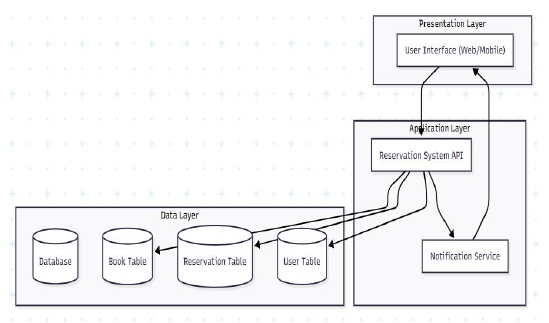

### Use cases
| Reserve Book | Borrow Book |
|---|---|
| 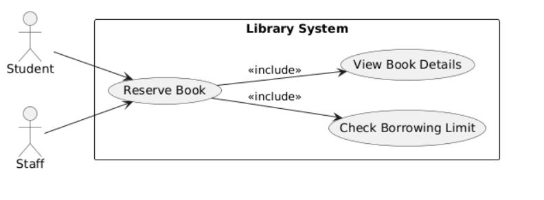 | 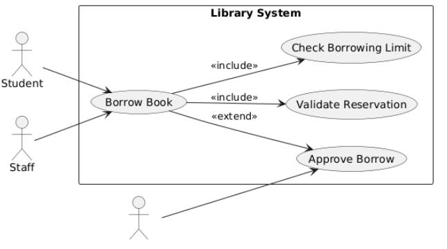 |

### Class diagrams
| Analysis class diagram | Design class diagram (layered) |
|---|---|
| 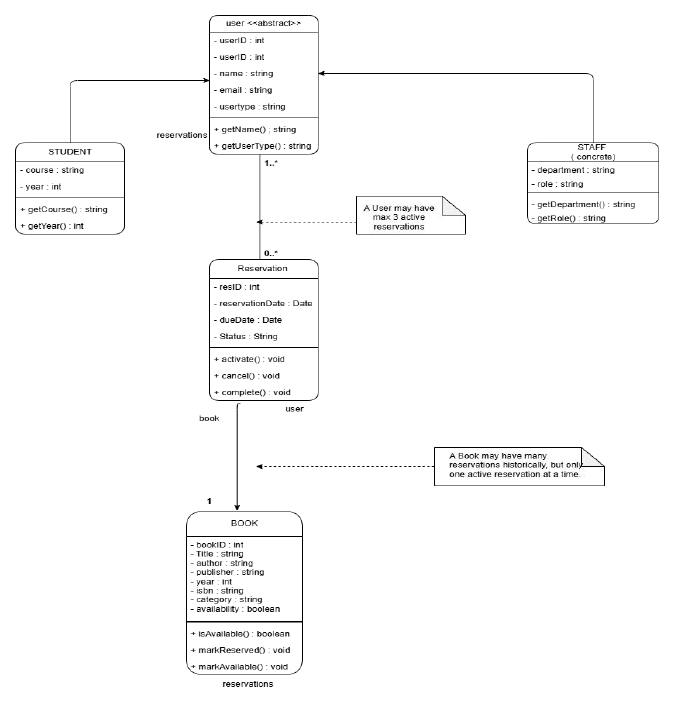 |  |

### Data model
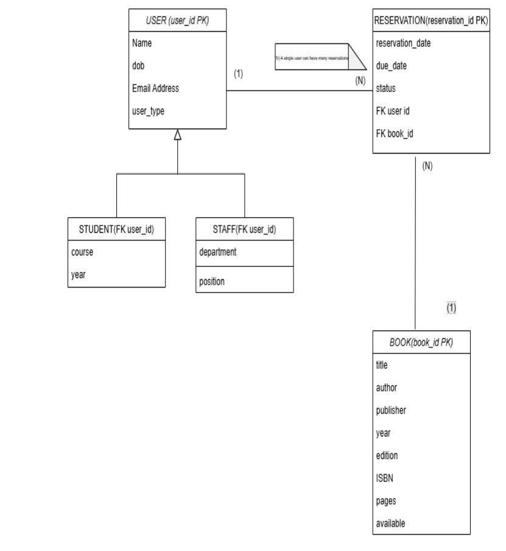

### Behaviour
| Sequence: reserve, collect & return | Reservation state chart |
|---|---|
| 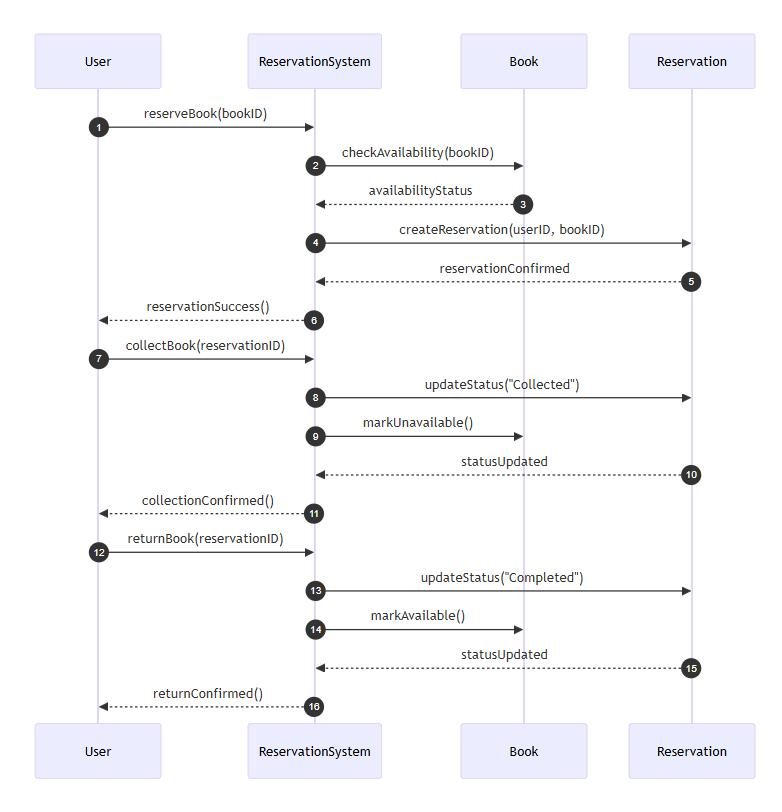 | 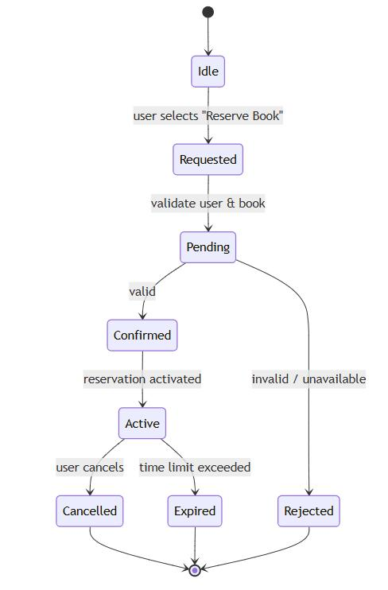 |

### Components & deployment
| Component diagram | Deployment diagram |
|---|---|
| 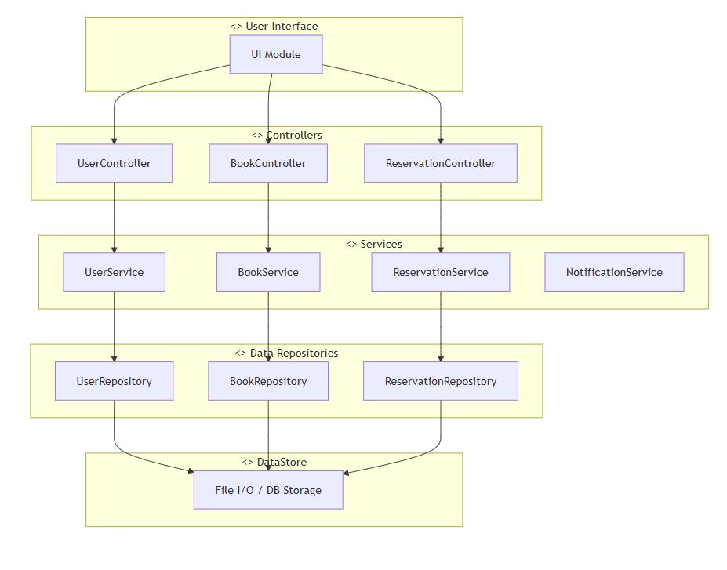 | 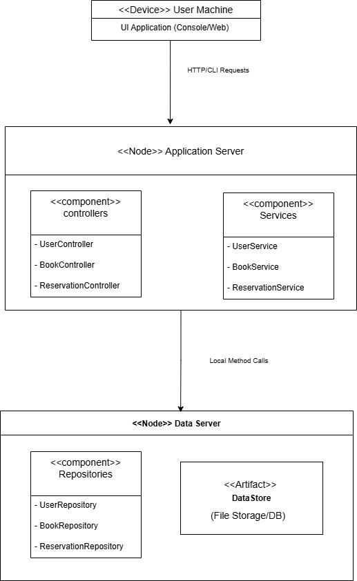 |

---

## 🏗️ Design patterns applied

| Pattern | Where it's used | Why |
|---|---|---|
| **MVC** | Whole system | Separates UI, business logic and data for maintainability |
| **Repository** | User, Book, Reservation repositories | Hides storage details, so files can later be swapped for a database |
| **Singleton** | Central DataStore | One shared, consistent source of data |
| **Factory Method** | Reservation creation | Centralises object creation and reduces duplication |
| **Strategy** | Book search (title, author, category) | Search methods can be swapped at runtime |
| **Observer** | Notifications | Email/SMS services are notified automatically when a reservation is confirmed, cancelled or expires |

| Strategy (search) | Factory Method (reservations) | Singleton (DataStore) |
|---|---|---|
| 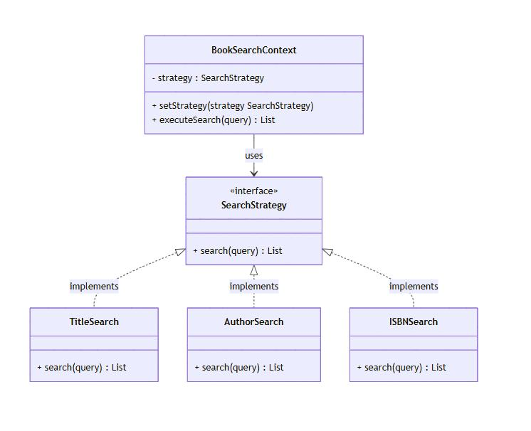 | 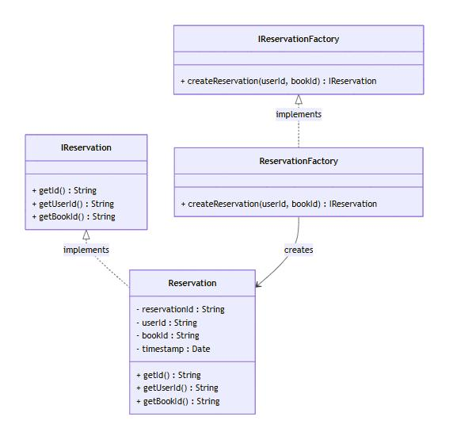 | 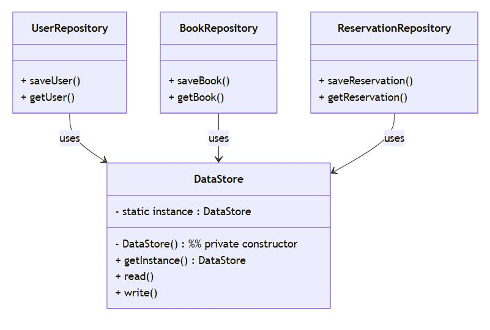 |

---

## 💻 Java prototype

`src/LibrarySystem.java` is a working console application that implements the core features of the design:

- **Login** for students/staff and librarians (role-based menus)
- **Search** books by title, author or ID
- **Reserve** and cancel reservations, with a **FIFO queue** per book and **automatic 48-hour expiry**
- **Borrow** and return books, with a **borrowing limit** (5 books per user) and reservation-queue priority checks
- **Librarian tools:** add, update and remove books (removal blocked while loans are active), view all loans and reservation queues

The prototype keeps everything in one file with in-memory storage, to focus on the business rules. The full layered architecture and design patterns are specified in the design report.

**Run it** (Java 11 or later):

```bash
javac -d out src/LibrarySystem.java
java -cp out LibrarySystem
```

**Sample logins:** student `U001` or `U002`; librarian `L001` (password `admin`)

---

## 🔄 Process

Followed an **Agile** approach with weekly sprints, tracked on a **GitHub Scrum board**: each sprint focused on specific deliverables (use cases, class diagrams, sequence diagrams), then refined earlier models in the next iteration.

---

## 🗂️ Files

| File | Description |
|---|---|
| `src/LibrarySystem.java` | Java console prototype |
| `software-design-report.pdf` | Full design report with all diagrams, patterns, code fragments and critique |
| `01-…13-*.png` | 13 UML and design-pattern diagrams (created in draw.io) |

## 🛠️ Skills & tools

Object-Oriented Design · UML · Design Patterns · Software Architecture · Requirements Engineering · Agile · Java · draw.io
